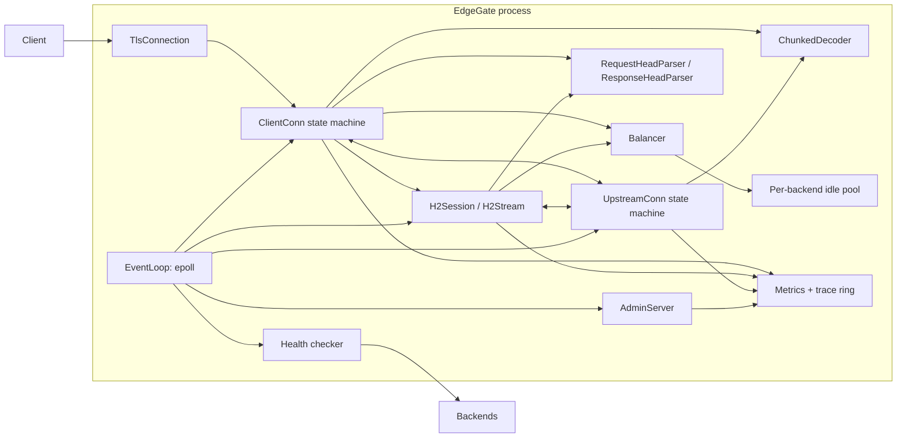

# EdgeGate 架构与源码导览

> 本文描述 `include/`、`src/`、`apps/`、`tests/` 中**当前可构建的源码**，供阅读、复刻和核对行为使用。项目定位是单机、单事件循环的 HTTP/1.1 + HTTP/2 教学代理，可选 TLS 终止，不是生产级 Nginx 替代品。

## 相关源码

| 文件 | 职责 |
| --- | --- |
| [`include/edgegate/buffer.hpp`](include/edgegate/buffer.hpp) | 连续可读区间 + 尾部可写空间；读指针不搬移，空间不足时压缩/扩容 |
| [`include/edgegate/http.hpp`](include/edgegate/http.hpp)、[`src/http.cpp`](src/http.cpp) | 请求/响应头解析、chunked 解码、逐跳头过滤、序列化、错误响应 |
| [`include/edgegate/tls.hpp`](include/edgegate/tls.hpp)、[`src/tls.cpp`](src/tls.cpp) | OpenSSL 上下文、证书、ALPN、非阻塞握手、`SSL_read/SSL_write` |
| [`src/h2_impl.inc`](src/h2_impl.inc) | nghttp2 HTTP/2 session、stream、请求/响应交换、流级背压 |
| [`include/edgegate/config.hpp`](include/edgegate/config.hpp)、[`src/config.cpp`](src/config.cpp) | INI 风格配置、严格校验、尺寸/超时/水位 |
| [`include/edgegate/metrics.hpp`](include/edgegate/metrics.hpp)、[`src/metrics.cpp`](src/metrics.cpp) | 原子计数、Gauge、固定桶直方图、Prometheus 文本 |
| [`include/edgegate/backend.hpp`](include/edgegate/backend.hpp)、[`src/backend.cpp`](src/backend.cpp) | 后端健康状态机、冷却、快照、round-robin/least-conn |
| [`include/edgegate/retry.hpp`](include/edgegate/retry.hpp)、[`src/retry.cpp`](src/retry.cpp) | 纯函数重试判定 |
| [`include/edgegate/event_loop.hpp`](include/edgegate/event_loop.hpp) | epoll 注册、事件分发、延迟关闭 fd |
| [`include/edgegate/proxy.hpp`](include/edgegate/proxy.hpp)、[`src/proxy.cpp`](src/proxy.cpp) | `ProxyServer` 实现、客户端/上游连接状态机、连接池、超时、trace |
| [`include/edgegate/admin.hpp`](include/edgegate/admin.hpp)、[`src/admin.cpp`](src/admin.cpp) | 管理端口、HTML 面板、JSON/指标/追踪路由 |
| [`include/edgegate/log.hpp`](include/edgegate/log.hpp)、[`src/log.cpp`](src/log.cpp) | 分级日志 |
| [`include/edgegate/util.hpp`](include/edgegate/util.hpp)、[`src/util.cpp`](src/util.cpp) | 时间、字符串、socket、地址解析 |
| [`apps/edgegate.cpp`](apps/edgegate.cpp) | 命令行入口、配置校验、启动 |
| [`apps/demo_backend.cpp`](apps/demo_backend.cpp) | 真实文件/API 演示后端 |
| [`apps/eg_loadgen.cpp`](apps/eg_loadgen.cpp) | keep-alive 压测器 |
| [`tests/`](tests/) | 6 个单元测试 + 26 个端到端场景（HTTP/1.1、TLS、HTTP/2） |

## 1. 目的与交付边界

EdgeGate 接收 HTTP/1.0/1.1 客户端请求，也可在 TLS 端口上通过 ALPN 协商 HTTP/1.1 或 HTTP/2。它按 `round_robin` 或 `least_conn` 选择一个后端，使用非阻塞 socket 转发请求头和请求体，再把响应头和响应体流式转发给客户端。它维护每后端连接池、主动/被动健康检查、超时、限流式的缓冲水位和可观测性。

- HTTP/1.1：连接级状态机，流式请求/响应；
- TLS：OpenSSL 非阻塞握手，TLS 1.2/1.3，ALPN；
- HTTP/2：nghttp2 server session，一个连接多 stream，每 stream 映射一个 HTTP/1.1 上游交换；
- 上游始终是明文 HTTP/1.1。

**不包含**：HTTP/3、h2c、HTTP/2 上游、server push、trailer 转发、客户端证书/mTLS、SNI 多证书、WebSocket/CONNECT、多 worker、配置热加载、管理端认证、缓存、动态服务发现。

## 2. 核心组件与数据流



| 层 | 拥有什么状态 | 对外提供什么 |
| --- | --- | --- |
| `EventLoop` | epoll fd、fd→handler 映射、延迟关闭列表 | `add/mod/remove/close_later/run_once` |
| `TlsConnection` | SSL、握手状态、ALPN | 非阻塞握手、`SSL_read/SSL_write`、`close_notify` |
| `ClientConn` | 客户端 fd、TLS、in/out Buffer、h1 请求上下文、trace | h1 读请求/转发/重试；h2 模式委托 H2Session |
| `H2Session` | nghttp2 session、stream map、TLS 输出缓冲 | 解析 SETTINGS/HEADERS/DATA、管理 stream 生命周期 |
| `H2Stream` | 单 stream 的方法/路径/body、响应解析、上游 owner 回调 | 选择后端、构造 h1 请求、提交 h2 响应、流级背压 |
| `UpstreamConn` | 上游 fd、in/out Buffer、连接/空闲标志 | 非阻塞 connect、部分写、事件转发给 `UpstreamOwner` |
| `Backend` | 健康/冷却/draining、计数、延迟直方图 | `selectable`、`record_success/failure`、snapshot |
| `Balancer` | 轮询游标 | 选择下一个可用后端（可排除） |
| `ProxyServer::Impl` | 所有连接、池、指标、trace ring、管理端 | 启动/停止、状态 JSON、Prometheus |

## 3. 事件循环与 fd 生命周期

`EventLoop` 是单线程 epoll 封装：

- `add(fd, events, handler)`：`EPOLL_CTL_ADD`，并记录 `handlers_[fd]`；
- `mod(fd, events)`：只更新关注事件；
- `remove(fd)`：从 epoll 摘除但**不关闭** fd，用于把上游连接放回池；
- `close_later(fd)`：摘除并在本批事件处理完后 `close`，避免回调中途 fd 号被复用；
- `run_once(timeout_ms)`：`epoll_wait`，逐个按 fd 查表分发；批次结束后统一关闭延迟关闭列表。

**为什么延迟关闭**：一次 `epoll_wait` 可能返回多个 fd；如果处理 A 时关闭了 B，而 B 的事件还在同一批里，B 的 handler 指针可能悬垂。延迟关闭 + 按 fd 查表使“已删除的 fd 不会在本批再次分发”，同时避免 fd 号在批次内被 accept 复用。

## 4. 缓冲与背压不变量

`Buffer` 维护 `r_`（读指针）和 `w_`（写指针）：

- `consume(n)` 只前进 `r_`，不搬移内存，因为调用方可能持有指向已读区间的 `string_view`；
- `reserve(n)` 在空间不足时先压缩已读前缀，再按 1.5x/2x 扩容；
- `view()` 只在下一次 `append/reserve` 前有效。

代理侧有三类水位：

| 缓冲 | 高水位后的动作 | 低水位后的动作 |
| --- | --- | --- |
| 客户端 out（响应） | 禁用上游 `EPOLLIN` | 恢复上游 `EPOLLIN` |
| 上游 out（请求体） | 禁用客户端 `EPOLLIN` | 恢复客户端 `EPOLLIN` |
| 全局 in+out 总和 | 所有连接进入全局背压 | 降到 75% 后解除 |

不变量：

1. 任何一次 `recv` 最多 64 KiB，因此实际缓冲 ≤ 高水位 + 64 KiB（单连接）；
2. `out` 非空时必须关注 `EPOLLOUT`；`out` 为空时取消；
3. 慢客户端超过 `client_write_stall_ms` 没有写进展会被关闭；
4. 连接池空闲连接不注册 epoll，不占用事件循环 CPU。

## 5. 客户端状态机

`ClientConn::State`：

```text
ReadRequest ──头完整──> Dispatching ──取到连接──> Connecting ──连接完成──> SendingBody
     ^                       │                         │                         │
     │                       └──无可用后端──> Draining/Closing                  │
     │                                                                         v
     └──────────────────────── 响应完成 <── StreamingResponse <── WaitingResponse
```

关键转换：

- `ReadRequest`：读客户端，增量解析请求头；解析错误直接返回 4xx/431/505 并关闭；
- `Dispatching`：暂停客户端读（避免在连接建立期间无限缓冲 body），选择后端；
- `Connecting`：等待上游 `EPOLLOUT`，检查 `SO_ERROR`；
- `SendingBody`：把 CL/chunked body 流式写入上游 out；上游 out 高水位时暂停客户端读；
- `WaitingResponse`：请求体已入队，等待上游响应头；
- `StreamingResponse`：解析响应头/体，写客户端 out；客户端 out 高水位时暂停上游读；
- `Draining`：响应已生成但 out 未排空；排空后回到 `ReadRequest` 或关闭。

**提前响应**：如果上游在请求体尚未发完时返回响应（例如 413），代理会停止转发 body、清空上游 out、标记连接不可复用，并在响应结束后关闭客户端连接。这样不会把“半截请求”误认为完整请求。

## 6. 请求/响应解析

### 6.1 请求头

`RequestHeadParser::parse()`：

1. 在 Buffer 中找 `\r\n\r\n`，超过 `max_request_header_bytes` 返回 431；
2. 解析请求行：方法、target、版本；只接受 HTTP/1.0/1.1；
3. absolute-form 目标拆出 authority 和 origin-form path；
4. 逐行解析头：拒绝 obs-fold、非法 token、控制字符；
5. 校验 Host 数量、Content-Length 冲突、Transfer-Encoding 与 Content-Length 共存；
6. 解析 `Connection` token、`Expect: 100-continue`、`Upgrade`；
7. 消费整个头部，body 留在 Buffer 中，由 `BodyMode` 决定如何读取。

限制：头部 32 KiB、200 个头、单头名 256 B、单头值 8 KiB、请求行 8 KiB。

### 6.2 chunked

`ChunkedDecoder` 是独立状态机：

```text
SizeLine -> Data -> DataCrlf -> SizeLine
   |                              |
   +-- size==0 --> TrailerLine --> Done
```

- 支持 chunk extension（丢弃）；
- chunk 上限 256 MiB，行长上限 8 KiB；
- trailer 保存下来供调用方使用（代理当前不转发 trailer，直接发送 `0\r\n\r\n`）；
- 返回 Data 时消费输入 Buffer，并返回指向缓冲区的 view；调用方必须在下一次 append/reserve 前复制。

### 6.3 响应

`ResponseHeadParser::parse(in, request_is_head, ...)` 根据请求方法和状态码决定 body 模式：

- HEAD / 1xx / 204 / 304 → 无 body；
- `Transfer-Encoding: chunked` → chunked；
- `Content-Length` → 定长；
- 都没有 → 读到连接关闭（HTTP/1.0 或 `Connection: close`）。

代理对 HTTP/1.1 客户端会把 chunked/close-delimited 响应重新分帧为 chunked，因此客户端连接仍可 keep-alive；HTTP/1.0 客户端则去分块并用关闭连接定界。

### 6.4 TLS 与 ALPN

`TlsContext` 是进程级 OpenSSL 上下文：

- `SSL_CTX_new(TLS_server_method())`；
- `SSL_CTX_set_min_proto_version`：只允许 TLS 1.2 或 1.3；
- 加载证书链和私钥并校验匹配；
- `SSL_CTX_set_alpn_select_cb`：`http2=true` 时服务端列表是 `h2,http/1.1`，否则只有 `http/1.1`；
- `SSL_OP_NO_COMPRESSION`、`SSL_MODE_ENABLE_PARTIAL_WRITE`、`SSL_MODE_ACCEPT_MOVING_WRITE_BUFFER`。

`TlsConnection` 是每客户端连接：

- `SSL_new` + `SSL_set_fd` + `SSL_set_accept_state`；
- `handshake()` 返回 `Ok/WantRead/WantWrite/Error`；
- `read()/write()` 把 `SSL_ERROR_WANT_READ/WANT_WRITE` 映射为 `IoStatus`；
- `alpn()` 返回协商结果；
- `shutdown()` 只发一次 `close_notify`，不等待对端。

`ClientConn` 在握手期间：

- 只关注握手需要的方向：`WantRead → EPOLLIN`，`WantWrite → EPOLLOUT`；
- 握手完成前不解析 HTTP；
- 握手超时用 `tls_handshake_timeout_ms`；
- 握手成功后根据 ALPN 选择 h1 或 h2。

TLS 只作用于客户端侧；上游始终是明文 HTTP/1.1。v1.1 不支持客户端证书、SNI 多证书、OCSP stapling 和证书热加载。

### 6.5 HTTP/2 前端

ALPN 选中 `h2` 后，`ClientConn::start_h2()` 创建 `H2Session`：

```text
H2Session
  ├── nghttp2_session (server)
  ├── streams: stream_id -> H2Stream
  ├── out Buffer (TLS 写缓冲)
  └── total_body 预算

H2Stream (每 stream 一个)
  ├── :method/:path/:authority + headers
  ├── body（缓冲，受上限）
  ├── Backend* / UpstreamConn*
  ├── ResponseHeadParser / ChunkedDecoder
  ├── pending response buffer + data provider
  └── RequestTrace
```

**连接建立**：

- `nghttp2_session_server_new2`，注册 begin_headers/header/data_chunk/frame_recv/stream_close 回调；
- 提交 SETTINGS：`MAX_CONCURRENT_STREAMS=http2_max_concurrent_streams`、`INITIAL_WINDOW_SIZE=1 MiB`；
- `nghttp2_session_mem_send` 产生的帧写入 `H2Session::out`，再通过 `ClientConn::client_write`（TLS）发出。

**stream 生命周期**：

1. `on_begin_headers` 创建 `H2Stream`，设置 nghttp2 stream user data；
2. `on_header` 收集 pseudo headers 和普通 headers，丢弃 h2 禁止的逐跳头；
3. `on_data_chunk_recv` 把 body 追加到 stream；超过单流/单连接上限标记 `too_large`；
4. `on_frame_recv` 收到 END_STREAM 后校验并 `dispatch()`；
5. `on_stream_close` 中止上游、提交 trace、加入回收队列；`H2Session::reap` 在回调外删除对象。

**请求映射**：

- h2 body 已完整缓冲，因此向上游发 `Content-Length`（不是 chunked）；
- 构造 `RequestHead`：method、path、authority、headers、content_length；
- 通过 `UpstreamOwner` 接口复用 `Impl::acquire_upstream`/连接池/健康检查；
- 非幂等请求写出字节后不重试；GET/HEAD 在响应前可重试；body 已完整缓冲所以可重放。

**响应**：

- `ResponseHeadParser` 解析上游 h1 响应；
- 响应头过滤后通过 `nghttp2_submit_response2` 提交；
- 无 body（HEAD/204/304）时 data provider 为空，nghttp2 直接 END_STREAM；
- 有 body 时注册 `nghttp2_data_provider2`，从 `pending` 拷贝数据；`pending` 为空且未完成时返回 `NGHTTP2_ERR_DEFERRED`，上游数据到达后 `nghttp2_session_resume_data`；
- `pending` 超过 `client_buffer_high` 时暂停上游读，data provider 消费到低水位后恢复；这就是 h2 的响应背压；
- 响应完成后释放上游连接；h2 流关闭由 nghttp2 在 data provider EOF 后触发。

**h2 请求体限制**：

- 单流 `http2_max_request_body_bytes`（默认 8 MiB）；
- 单连接 `http2_max_total_request_body_bytes`（默认 32 MiB）；
- 超限返回 413；这是 v1.1 的明确取舍，不是流式 h2 请求体实现。

**h2 错误**：

- 上游失败且尚未提交响应头 → 502/504 响应；
- 已提交响应头 → `RST_STREAM(INTERNAL_ERROR)`；
- 客户端 RST/EOF → 中止上游、提交 trace、关闭连接；
- 超时：`upstream_response_timeout_ms` 与 `request_timeout_ms` 按 stream 计时。

**h2 边界**：不支持 h2c、HTTP/2 上游、server push、trailer 转发、流优先级；h2 只通过 TLS/ALPN 提供。

## 7. 连接池

池按 `Backend*` 维护 `std::deque<UpstreamConn*>`：

- `acquire_upstream()`：
  - 取 idle 队首，先用 `recv(MSG_PEEK|MSG_DONTWAIT)` 检查连接；
  - 返回 0（EOF）、>0（脏数据）或其他错误 → 丢弃；
  - 否则清空 in/out、设为 assigned、增加 active 计数、重新注册 epoll。
- 无 idle 且 `active + idle < max_connections` → 新建非阻塞连接；
- 达到上限 → 返回 `pool_full`，调用方换后端；
- `release_upstream(up, reusable)`：
  - 可复用且 idle 未满 → `loop.remove(fd)`，放回队列，增加 idle 计数；
  - 否则 `destroy_upstream()` 关闭。
- `sweep_idle()` 每 100 ms 扫描队首，关闭超过 `backend_idle_timeout_ms` 的连接。

**复用条件**：上游响应 `keep-alive`、响应有明确帧边界（不是 close-delimited）、没有 101、请求没有提前中止、`up->in` 为空、没有关闭标记。

## 8. 负载均衡与健康

`Backend` 状态：

```text
healthy=true, failures=0, successes=0
  record_failure -> failures++ ; failures>=threshold -> healthy=false
  record_success -> failures=0 ; successes++ ; if !healthy && successes>=threshold -> healthy=true
  connect_failure -> cooldown_until = now + cooldown_ms
selectable(now) = healthy && !draining && now >= cooldown_until
```

- `round_robin`：从游标开始找第一个 selectable 且不在 exclude 的后端；
- `least_conn`：选择 `active_connections` 最小者，平局按游标顺序；
- 主动健康检查每次只允许一个在途连接（`health_check_in_progress`），超时/失败计入被动失败；
- 管理端 drain 只影响 `selectable`，不会杀死已有连接；enable 立即恢复（若健康）。

## 9. 重试

`can_retry(RetryInput)` 是纯函数，输入包括方法、已尝试次数、是否写出请求字节、是否已转发 body、body 是否完整、是否可重放、是否已收到响应。

```cpp
if (response_started) return false;
if (attempts_done >= max_attempts) return false;
if (!idempotent && idempotent_only && request_bytes_written) return false;
if (body_forwarded && !(body_complete && body_replayable)) return false;
return true;
```

`ClientConn::on_upstream_failure()` 在失败后：

- 标记后端失败/冷却；
- 如果尚未收到响应且 `can_retry()`，重置响应解析状态，重新选择后端；
- 如果已收到部分响应，直接关闭客户端（不能拼接两段响应）；
- 否则返回 502/504。

body 重放缓冲只保存“已转发的解码后字节”，上限 `retry_body_buffer_bytes`；超出后 `replay_ok=false`，后续失败不再重试。

## 10. 可观测性与管理端

`Metrics` 使用原子计数和固定桶直方图（1/2/5/10/25/50/100/250/500/1000/2500/5000 ms + Inf）。单线程下原子不是必须的，但为未来多 worker 预留。

`RequestTrace` 环形缓冲 256 条，记录：

- request id、客户端 IP、方法、路径；
- 最终后端、attempts、是否重试；
- 状态码、错误、duration/ttfb/connect；
- 请求/响应字节数、chunked 标志、keep-alive；
- 起始墙钟时间。

`AdminServer` 是独立 fd/监听端口：

- 接受连接后读一个请求头；
- 路由 `/`、`/healthz`、`/api/status`、`/api/requests`、`/api/requests/<id>`、`/metrics`、`/api/backends/<name>/drain|enable`；
- 响应固定 `Connection: close`，不参与代理转发；
- 管理连接 30 秒无响应会被回收。

## 11. 构建与验证入口

`CMakeLists.txt`：

- `edgegate_core`：util/log/tls/http/config/metrics/backend/retry/admin/proxy；`proxy.cpp` 在 `EDGEGATE_HAVE_NGHTTP2` 下包含 `src/h2_impl.inc`；
- 依赖：OpenSSL（TLS/SHA-256）、Threads；nghttp2 可选，找到则启用 HTTP/2，否则只提供 TLS/HTTP1.1；
- `edgegate`：主程序；
- `eg_demo`：演示后端；
- `eg_loadgen`：压测器；
- CTest：`buffer_test`、`http_test`、`config_test`、`balancer_test`、`retry_test`、`metrics_test`、`integration_test`。

集成测试用 Python 标准库启动真实进程；HTTP/1.1 场景用原始 socket，TLS/HTTP2 场景用 `curl --http1.1`/`curl --http2`（自签名证书 + `-k`）。覆盖文件哈希、chunked、keep-alive、故障转移、重试、慢客户端背压、TLS、ALPN h2、多路复用、h2 413/504 和 h2 重试。

构建 HTTP/2 需要：

```bash
sudo apt install -y libssl-dev libnghttp2-dev
cmake -S . -B build -G Ninja -DCMAKE_BUILD_TYPE=Release
cmake --build build -j
ctest --test-dir build --output-on-failure
```

没有 nghttp2 时 CMake 会打印警告，TLS/HTTP1.1 仍可构建；集成测试会检测 ALPN 是否协商到 h2，未协商则跳过 h2 场景。

## 12. 继续实现时的边界

1. **先复现，再重写**：先用集成测试确认当前行为，再按状态机和解析器接口自己实现。
2. **TLS 与 HTTP/2 是两条状态机**：TLS 的 `WANT_READ/WANT_WRITE` 要映射回 epoll；HTTP/2 的 stream 生命周期、流控和 data provider 与 HTTP/1.1 的连接状态机不同。
3. **h2 请求体目前是缓冲的**：真正的流式 h2 请求体需要把 h2 DATA 与上游写缓冲、h2 窗口更新联动；当前用上限换实现清晰度。
4. **多 worker 需要重新设计状态**：后端健康、连接池、指标、trace ring 都要么分片要么共享；不能直接把单线程代码复制到多线程。
5. **重试需要业务幂等键**：当前只按 HTTP 方法；生产系统常需要 `Idempotency-Key` 或业务去重表。
6. **背压只覆盖应用层**：内核 socket 缓冲仍可能吸收数据；真实高延迟链路上需要更细的窗口/速率控制。
7. **管理端安全**：没有认证；如果监听非 loopback，必须先加认证、mTLS 或反向代理保护。
