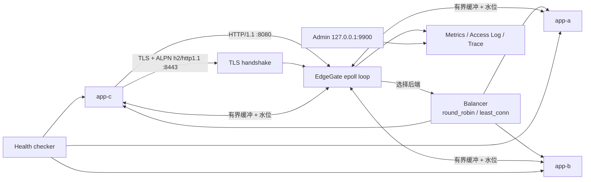
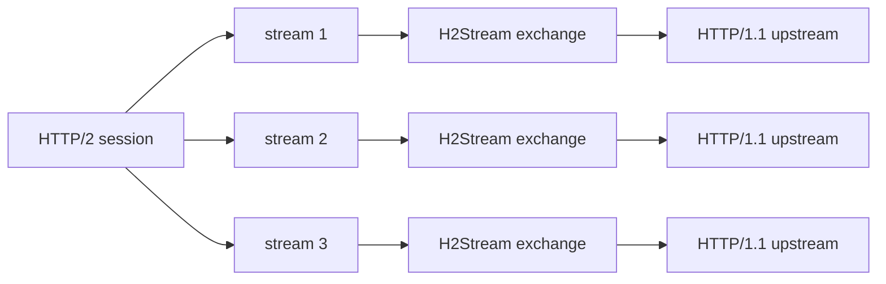
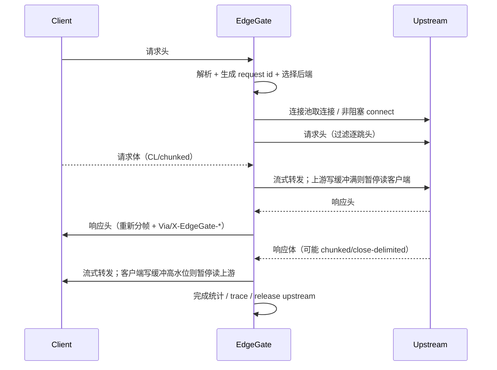

# EdgeGate：C++20 HTTP/1.1 + HTTP/2 反向代理与负载均衡器

EdgeGate 是一个面向 Linux/WSL2 的单线程非阻塞反向代理：客户端只访问 EdgeGate，它按负载均衡策略选择后端、转发请求与响应，并在后端异常时摘除实例、按安全规则重试。项目重点不是“再写一个 Nginx”，而是把代理里最容易讲清楚、也最容易做错的几件事做完整并给出可复现验证：

- **非阻塞事件循环**：epoll、部分读写、连接生命周期、超时；
- **TLS 终止**：OpenSSL 非阻塞握手、证书、TLS 1.2/1.3、ALPN；
- **HTTP/2 前端**：nghttp2 多路复用、流级响应、流控与背压，后端仍是 HTTP/1.1；
- **有界缓冲与背压**：慢客户端时暂停读取上游（HTTP/1.1 与 HTTP/2 都适用）；
- **连接池与负载均衡**：keep-alive 复用、每后端连接上限、主动/被动健康检查、恢复；
- **请求语义**：Content-Length / chunked、`100-continue`、HEAD/204/304、HTTP/1.0、逐跳头过滤；
- **重试安全边界**：POST/PATCH 写出请求后绝不无条件重发；
- **可观测性**：Prometheus 指标、JSON 访问日志、请求级 trace、内置管理面板。

当前源码对应 **v1.1**。明确未实现 HTTP/3、h2c、上游 TLS、客户端证书、WebSocket/CONNECT、多 worker 和配置热加载；这些是扩展方向，而不是“已经支持但没写文档”。

> 定位：单机、单事件循环的教学/面试级代理。它接受真实 HTTP/1.1/HTTP/2 流量，但不宣称生产级高可用、TLS 集群或百万并发。

## 当前能力

| 模块 | 状态 |
| --- | --- |
| HTTP/1.1 代理 | 请求行/头/体转发，keep-alive，HTTP/1.0 客户端，absolute-form |
| TLS 终止 | OpenSSL 非阻塞握手、`tls_cert/tls_key`、TLS 1.2/1.3、ALPN、握手超时 |
| HTTP/2 前端 | nghttp2 server session、ALPN h2、GET/POST、多路复用、流级响应、流控 |
| 请求体 | HTTP/1.1：CL/chunked 流式；HTTP/2：缓冲至 `http2_max_request_body_bytes` |
| 响应体 | CL、chunked、close-delimited；HTTP/1.1 自动重新分帧；HTTP/2 data provider 流式 |
| 特殊响应 | HEAD、204、304、1xx interim、101（转发后关闭） |
| 逐跳头 | 过滤 `Connection`、`Keep-Alive`、`TE`、`Trailer`、`Transfer-Encoding`、`Upgrade` 等 |
| 客户端信息 | `X-Forwarded-For`、`X-Forwarded-Proto`、`X-Forwarded-Host`、`Via`、`X-Request-Id` |
| 连接池 | 每后端 idle 队列、最多连接数、idle 超时、复用前 `MSG_PEEK` 探活 |
| 负载均衡 | `round_robin`、`least_conn`（活跃连接数） |
| 健康检查 | 主动 HTTP GET、被动连接/读写失败、阈值、冷却、恢复 |
| 重试 | 幂等请求在未收到响应时可重试；非幂等请求写出字节后禁止重试；body 可重放才重试 |
| 背压 | HTTP/1.1 双向水位；HTTP/2 响应 pending 高水位暂停上游读；全局缓冲预算 |
| 超时 | 客户端头/空闲/写停顿、TLS 握手、上游连接/响应、总请求、shutdown grace |
| 可观测性 | Prometheus `/metrics`、`/api/status`、`/api/requests`、request trace、HTML 面板、JSONL access log |
| 运维控制 | 后端 drain/enable（管理端）、优雅停机、SIGHUP 提示未实现热加载 |
| 演示与验证 | 3 实例演示后端、真实文件上传/下载、登录 API、hash 校验、C++ 压测器、Python 端到端测试 |

**明确未实现**

- HTTP/3、h2c（明文 HTTP/2）、HTTP/2 上游、server push、HTTP/2 trailer 转发；
- 上游 TLS/mTLS、客户端证书认证、多证书/SNI 路由、OCSP stapling；
- WebSocket、CONNECT 隧道、协议升级（返回 501）；
- 多 worker/多线程事件循环、SO_REUSEPORT；
- 配置热加载（SIGHUP 只记录日志）；
- 管理端认证（默认只绑定 127.0.0.1）；
- 缓存、压缩、限流、WAF、动态服务发现。

## 快速开始

环境要求：

- Linux 或 WSL2（推荐 Ubuntu 24.04+）；
- GCC 13+ / Clang 17+，CMake 3.22+；
- Linux epoll；Windows 原生目标会在 CMake 配置阶段拒绝；
- 演示后端需要 `libcrypto` 运行库（Ubuntu 默认已有 `libcrypto.so.3`；标准开发环境可 `apt install libssl-dev`）。

```bash
cmake -S . -B build -G Ninja -DCMAKE_BUILD_TYPE=Release
cmake --build build -j
ctest --test-dir build --output-on-failure
```

启动三个演示后端与代理（三个终端或在脚本里后台启动）：

```bash
mkdir -p /tmp/egdemo/root /tmp/egdemo/uploads
echo "hello edgegate" > /tmp/egdemo/root/hello.txt

./build/eg_demo --listen 127.0.0.1:9001 --name app-a \
  --root /tmp/egdemo/root --uploads /tmp/egdemo/uploads &
./build/eg_demo --listen 127.0.0.1:9002 --name app-b \
  --root /tmp/egdemo/root --uploads /tmp/egdemo/uploads &
./build/eg_demo --listen 127.0.0.1:9003 --name app-c \
  --root /tmp/egdemo/root --uploads /tmp/egdemo/uploads &

./build/edgegate --config config/edgegate.conf
```

验证：

```bash
curl -i http://127.0.0.1:8080/api/info
curl -i http://127.0.0.1:8080/files/hello.txt
curl -s http://127.0.0.1:9900/api/status | head -c 500
```

上传/下载真实文件并比对哈希：

```bash
head -c 1048576 /dev/urandom > /tmp/upload.bin
curl -sS -X PUT --data-binary @/tmp/upload.bin \
  http://127.0.0.1:8080/uploads/upload.bin
curl -sS http://127.0.0.1:8080/uploads/upload.bin -o /tmp/download.bin
sha256sum /tmp/upload.bin /tmp/download.bin
```

启用 TLS 与 HTTP/2（同时保留 8080 明文端口）：

```bash
bash scripts/gen_test_cert.sh certs
./build/edgegate --config config/edgegate-tls.conf

# HTTP/1.1 over TLS
curl -k --http1.1 -i https://127.0.0.1:8443/api/info | head
# HTTP/2 over TLS（ALPN h2）
curl -k --http2 -i https://127.0.0.1:8443/api/info | head
curl -k --http2 -o /dev/null -w 'HTTP version: %{http_version}\n' \
  https://127.0.0.1:8443/api/info
```

`curl -k` 仅用于自签名测试证书；生产环境应使用受信任证书，并关闭 `-k`。

内置管理面板：浏览器打开 `http://127.0.0.1:9900/`，可以看到后端健康状态、连接数、请求分布、P95 延迟、缓冲占用和最近请求 trace。

## 系统架构



HTTP/2 连接内部：



一次请求的生命周期：



核心原则：

- **单线程事件循环**：所有 fd 状态都在一个线程里，无锁；代价是无法利用多核，v1 明确不做多 worker。
- **所有缓冲都有上限**：读之前看水位，写不出去就停读；慢客户端不会把进程内存吃光。
- **连接是状态机，不是函数调用**：connect、部分写、响应体、客户端断开都通过事件推进。
- **重试是语义问题，不是网络问题**：只有确认请求没有产生后端可见副作用时才重发。
- **TLS 是传输层状态机**：握手未完成时只关注握手需要的事件；`SSL_read/SSL_write` 的 `WANT_READ/WANT_WRITE` 映射回 epoll。
- **HTTP/2 是流级并发**：一个 TLS 连接上多个 stream，每个 stream 映射到一个 HTTP/1.1 上游交换；响应通过 nghttp2 data provider 流式发送。
- **“可用”要能被观测**：每个后端有健康状态、活跃/空闲连接、延迟分位数和错误计数。

## 主要模块与用法

### 1. 配置

`config/edgegate.conf` 是简单的 INI 风格文本，严格校验未知键与非法值：

```ini
listen = 0.0.0.0:8080
admin_listen = 127.0.0.1:9900
balancer = least_conn
max_attempts = 2
preserve_host = true
client_buffer_high_watermark = 256K
client_buffer_low_watermark = 64K
upstream_buffer_high_watermark = 256K
upstream_buffer_low_watermark = 64K
health_interval_ms = 5000
health_timeout_ms = 1000
health_path = /healthz
healthy_threshold = 2
unhealthy_threshold = 3

# TLS / HTTP2（可选）
tls_listen = 0.0.0.0:8443
tls_cert = certs/cert.pem
tls_key = certs/key.pem
tls_min_version = 1.2
http2 = true
http2_max_request_body_bytes = 8M
http2_max_total_request_body_bytes = 32M
http2_max_concurrent_streams = 32

access_log = -
log_level = info

[backend app-a]
url = http://127.0.0.1:9001
```

`--check-config` 只校验并打印生效配置，不监听端口：

```bash
./build/edgegate --config config/edgegate.conf --check-config
```

关键配置：

| 配置 | 作用 |
| --- | --- |
| `max_attempts` | 总尝试次数；1 = 不重试 |
| `retry_idempotent_only` | 默认 true；false 会允许非幂等重试，仅用于明确知道后果的场景 |
| `retry_body_buffer_bytes` | 为可重放 body 保留的缓冲上限；超出后该请求不再重试 |
| `*_buffer_*_watermark` | 双向缓冲高低水位；低水位必须小于高水位 |
| `max_total_buffered_bytes` | 全局缓冲预算，超过后对客户端施加全局背压 |
| `max_connections_per_backend` | 活跃 + 空闲连接上限；达到后换后端或返回 502 |
| `health_interval_ms` | 0 表示关闭主动检查，只保留被动失败 |
| `access_log` | `-` 写 stderr，`off` 关闭，其他值为 JSONL 路径 |

### 2. HTTP 语义

- 请求目标支持 origin-form 与 absolute-form；`CONNECT`/`Upgrade` 返回 501。
- 请求头限制 32 KiB、最多 200 个头；响应头限制 64 KiB；超限返回 431。
- `Content-Length` 与 `Transfer-Encoding` 同时出现、重复冲突的 `Content-Length`、非法 chunk 大小、obs-fold 都会返回 400，用于抵御请求走私类问题。
- 请求 `chunked` 会被解码后重新分帧给上游；响应 `chunked` 对 HTTP/1.1 客户端重新分帧。
- 上游响应没有 `Content-Length`/`Transfer-Encoding` 时，代理重新 chunked 给 HTTP/1.1 客户端，因此客户端连接仍可复用；HTTP/1.0 客户端则以关闭连接定界。
- `Expect: 100-continue`：代理先回 100 Continue，再从客户端读 body，并向上游去掉 `Expect` 头。
- 逐跳头按 `Connection` 头中的 token 过滤；`X-Forwarded-For` 追加而不是覆盖。
- 每个响应带 `Via: 1.1 edgegate`、`X-EdgeGate-Request-Id`、`X-EdgeGate-Upstream`。

### 3. 连接池、负载均衡与健康检查

- 每个后端维护一个 idle 队列；复用前用 `recv(MSG_PEEK|MSG_DONTWAIT)` 检查连接是否已被对端关闭或出现脏数据。
- 上游响应完成后，只有“keep-alive + 有明确帧边界 + 没有多余字节”的连接才会回到池里；否则关闭。
- `round_robin` 跳过不健康、draining、冷却中的后端；`least_conn` 选择活跃连接最少者，平局按轮询顺序打破。
- 主动健康检查：每 `health_interval_ms` 发一次 `GET health_path`，2xx/3xx 成功；失败累计到 `unhealthy_threshold` 后摘除，成功累计到 `healthy_threshold` 后恢复。
- 被动失败：连接失败立即进入短冷却，读写失败/5xx 累计失败；健康检查成功会清零失败计数。
- 管理端 `POST /api/backends/<name>/drain` 可停止向实例派发新请求，`.../enable` 恢复。

### 4. 重试的安全边界

重试规则在 `include/edgegate/retry.hpp` 中独立可测：

| 情况 | 是否重试 |
| --- | --- |
| 连接失败，尚未写出任何请求字节 | 是（任何方法） |
| GET/HEAD/OPTIONS/TRACE/PUT/DELETE，已写 head，未收到响应 | 是 |
| POST/PATCH，已写出任何请求字节 | 否 |
| 已收到任何响应字节 | 否 |
| body 只转发了一部分且无法完整重放 | 否 |
| 达到 `max_attempts` | 否 |

重试只发生在“选择下一个后端并重新建立连接”的层面；不会在已经发送了不可重放请求体后重发。POST 在连接建立前失败（没有任何字节到达后端）仍可重试，因为后端没有可观察副作用。

### 5. 背压

响应方向：

```text
上游 recv -> Buffer(in) -> 解析 -> Buffer(client out) -> send 客户端
                                   |
                       out.size() >= high ?
                                   |
                         暂停上游 EPOLLIN
```

- 客户端写缓冲达到 `client_buffer_high_watermark` 时，禁用上游 fd 的 `EPOLLIN`；
- 客户端可写事件把 out 缓冲降到 `client_buffer_low_watermark` 以下后，恢复上游读；
- 反向请求体同理：上游写缓冲高水位时暂停客户端 `EPOLLIN`；
- 全局缓冲超过 `max_total_buffered_bytes` 时，对所有连接施加全局背压；
- 客户端长时间不读（`client_write_stall_ms`）会被断开，避免一个死连接永久占用内存。

实测（4 MiB 响应，客户端 16 KiB / 20 ms）：

```text
backpressure: buffered<=262144B pauses=30 rss=7932KiB
```

即应用层缓冲被限制在约 256 KiB，进程 RSS 约 5.6–7.9 MiB，并且确实发生了 15–30 次“暂停/恢复上游读取”。

### 6. 超时与连接生命周期

| 超时 | 默认 | 触发后 |
| --- | --- | --- |
| `client_header_timeout_ms` | 10 s | 408 / 关闭 |
| `client_idle_timeout_ms` | 60 s | 关闭空闲 keep-alive |
| `client_write_stall_ms` | 30 s | 关闭慢客户端 |
| `upstream_connect_timeout_ms` | 2 s | 504，可重试 |
| `upstream_response_timeout_ms` | 30 s | 504，按重试规则处理 |
| `request_timeout_ms` | 120 s | 504（响应开始前） |
| `shutdown_grace_ms` | 5 s | 停止 accept，等待在途请求，超时强制关闭 |

客户端提前断开时，代理会中止上游请求并销毁连接（不把半截连接放回池）；上游异常断开时，未开始响应的请求按重试规则处理，已经开始响应的连接直接关闭客户端，避免把截断的 body 当成完整响应。

### 7. 可观测性

管理端口（默认 `127.0.0.1:9900`）：

- `/`：HTML 面板，2 秒刷新；
- `/api/status`：完整 JSON 状态；
- `/api/requests?limit=20`：最近请求；
- `/api/requests/<id>`：单个请求 trace；
- `/metrics`：Prometheus 文本；
- `POST /api/backends/<name>/drain|enable`。

Prometheus 指标包括：

```text
edgegate_requests_total
edgegate_responses_total
edgegate_active_clients / active_requests / buffered_bytes
edgegate_errors_total{reason="parse|connect|read|write|timeout|no_backend|body_too_large|upstream_eof"}
edgegate_retries_total
edgegate_bytes_in_total / bytes_out_total
edgegate_upstream_read_paused_total / resumed_total
edgegate_client_read_paused_total / resumed_total
edgegate_backend_healthy{backend="app-a"}
edgegate_backend_active_connections{backend="app-a"}
edgegate_backend_idle_connections{backend="app-a"}
edgegate_backend_requests_total{backend="app-a"}
edgegate_backend_latency_ms{backend="app-a",quantile="0.95"}
edgegate_request_duration_ms_bucket{le="..."}
```

访问日志是 JSONL，包含 `request_id/client/method/path/status/upstream/attempts/duration_ms/ttfb_ms/bytes_in/bytes_out/retried/error`。`X-EdgeGate-Request-Id` 与访问日志、trace、管理面板使用同一个 ID。

### 8. 演示后端与压测器

`eg_demo` 是真实的 HTTP/1.1 文件/API 服务（线程每连接，刻意简单）：

- `GET /healthz`、`GET /api/info`；
- `GET /files/<name>`：从 `--root` 下载文件，支持 `Range`、`ETag`、`If-None-Match`；
- `PUT /uploads/<name>`：流式上传，临时文件 + fsync + rename，返回 SHA-256；
- `POST /api/echo`：计算请求体大小与 SHA-256，不落盘；
- `POST /api/login` / `GET /api/whoami`：演示跨实例可校验的无状态 token；
- `GET /api/bulk?mb=N`：大响应，用于背压/吞吐测试；
- `GET /api/chunked?chunks=N&size=N`：chunked 响应；
- `GET /api/close`：close-delimited 响应；
- `GET /api/no-content`：204；
- `GET /api/delay?ms=N`、`GET /api/fail?code=N`：超时/失败注入。

`eg_loadgen` 是固定连接数的 keep-alive 压测器：

```bash
./build/eg_loadgen --url http://127.0.0.1:8080 --path /api/info \
  --connections 8 --requests 12500 --warmup 1000
```

输出 `requests/errors/non_2xx/elapsed/qps/bytes/p50/p90/p95/p99/max`。

### 9. TLS 终止与 ALPN

`config/edgegate-tls.conf` 同时保留明文 8080 和 TLS 8443：

```ini
listen = 0.0.0.0:8080
tls_listen = 0.0.0.0:8443
tls_cert = certs/cert.pem
tls_key = certs/key.pem
tls_min_version = 1.2
http2 = true
```

生成自签名测试证书：

```bash
bash scripts/gen_test_cert.sh certs
```

- OpenSSL 非阻塞握手：`SSL_accept` 返回 `WANT_READ/WANT_WRITE` 时映射为 epoll 事件；
- 握手完成前不解析 HTTP，握手超过 `tls_handshake_timeout_ms` 关闭；
- ALPN 服务端列表：`h2,http/1.1`（`http2=true`）或 `http/1.1`；
- 客户端不支持 h2 时自动回落到 HTTP/1.1；
- 关闭时发一次 `close_notify`，不等待对端，避免慢客户端拖住 shutdown。

```bash
curl -k --http1.1 https://127.0.0.1:8443/api/info
curl -k --http2  https://127.0.0.1:8443/api/info
openssl s_client -connect 127.0.0.1:8443 -alpn h2 -brief </dev/null
```

### 10. HTTP/2 前端（h2 → h1）

HTTP/2 只在前端启用（ALPN 协商 h2），上游仍使用 HTTP/1.1：

- 每个 h2 stream 映射为一个 `H2Stream` 交换：独立选择后端、独立上游连接、独立 trace；
- 请求体在内存中缓冲，上限 `http2_max_request_body_bytes`（默认 8 MiB），单连接总上限 `http2_max_total_request_body_bytes`（默认 32 MiB）；超限返回 413；
- 响应头通过 `nghttp2_submit_response2` 提交，响应体由 data provider 按 h2 流控窗口拉取；pending 高水位时暂停上游读，低水位恢复（与 h1 背压同思路）；
- 支持 HEAD/204/304、chunked/close-delimited 上游响应、`/api/bulk` 大文件；
- 非幂等请求写出字节后仍不重试；GET/HEAD 在响应前可以重试；
- `http2_max_concurrent_streams` 控制并发流数量。

```bash
curl -k --http2 -o /dev/null -w '%{http_version}\n' https://127.0.0.1:8443/api/info
# 输出 2

# 多路复用：两个 URL 共用一个 TLS 连接
curl -k --http2 --parallel \
  -o /tmp/a -o /tmp/b \
  https://127.0.0.1:8443/api/delay?ms=400 \
  https://127.0.0.1:8443/api/info
```

**v1.1 的边界**：请求体是缓冲而非流式；不支持 h2c、HTTP/2 上游、server push 和 trailer 转发。这些在 [docs/http2.md](docs/http2.md) 中展开。

## 关键设计决策

### 单线程 epoll，而不是线程池

代理的每个请求都要同时推进客户端和上游两个方向的状态；单线程让状态机不需要锁，调试和复现都简单。代价是 CPU 单核上限：8/32 连接时约 2.6–3.0 万 QPS，而直连后端可以到 34–42 万 QPS（多线程压测器 + 多线程后端）。v1 明确不做多 worker。

### 软水位 + 硬上限

水位是“暂停读取”的阈值，不是分配上限；单次 recv 最多 64 KiB，所以实际缓冲可能略高于高水位。全局预算再兜底。慢客户端测试中应用层缓冲最大 262144 B。

### 重放缓冲只保留必要部分

只有可能重试的请求才需要保留 body。默认上限 1 MiB；超过后该请求标记为不可重放，后续失败直接返回 502。这样既支持 GET/PUT 的常见重试，又不会为了 POST 大文件无限缓存。

### 逐跳头过滤 + 明确帧边界

代理不转发 `Connection` 及其 token 指定的头，也不盲目相信上游的 `Content-Length`。响应体结束条件由解析器统一决定；连接池只接受“刚好读完”的连接，避免把下一条响应误当成本条。

### 管理面独立端口

管理端没有认证，因此默认只绑定 `127.0.0.1`；如果配置成非 loopback，启动时打印警告。业务端口与管理端口分离，避免 `/metrics` 与真实业务路径冲突。

### TLS 握手与 HTTP 解析解耦

`TlsConnection` 只负责“握手/读/写”和 `WANT_READ/WANT_WRITE`；`ClientConn` 在握手完成前不解析 HTTP。这样 h1 与 h2 都能复用同一套 TLS 传输，ALPN 结果只决定之后走哪条协议路径。

### h2 stream 是独立交换

一个 HTTP/2 连接上每个 stream 都有自己的后端选择、上游连接、响应解析和 trace。`UpstreamOwner` 接口让 h1 的 `ClientConn` 与 h2 的 `H2Stream` 共用连接池、健康检查和重试规则，而不是复制一套网络层。

### h2 请求体先缓冲，响应体流式

v1.1 选择把 h2 请求体缓冲到上限（默认 8 MiB），这样可以用 Content-Length 精确构造 HTTP/1.1 上游请求，避免 h2 流式 body 与 h1 chunked/CL 的复杂映射。响应体则必须流式：通过 nghttp2 data provider + pending 高水位暂停上游读，否则大文件会 OOM。这个取舍在 [docs/http2.md](docs/http2.md) 中明确记录。

## 测试

```bash
ctest --test-dir build --output-on-failure
```

| 测试 | 覆盖 |
| --- | --- |
| `buffer_test` | append/consume/compaction/扩容/二进制数据 |
| `http_test` | 请求/响应解析、半包、chunked、错误输入、逐跳头、序列化 |
| `config_test` | 默认值、section、未知键、重复 backend、非法尺寸/超时、TLS 必填项 |
| `balancer_test` | round-robin、least-conn、健康/冷却/draining、排除 |
| `retry_test` | POST/GET 重试矩阵、attempt 上限、不可重放 body |
| `metrics_test` | 计数器/直方图/分位数/Prometheus 输出 |
| `integration_test` | 26 个端到端场景（HTTP/1.1 + TLS + HTTP/2，见下） |

集成测试会启动 3 个真实 `eg_demo` 实例和代理，覆盖：

- 真实 GET/HEAD/204、keep-alive、上游连接池；
- 3 MiB 文件下载哈希、1 MiB CL 上传、512 KiB chunked 上传、256 KiB chunked echo；
- chunked 响应、close-delimited 响应重新分帧后连接复用；
- `Expect: 100-continue`、HTTP/1.0、管线化；
- 请求走私类错误（CL+TE、超大 header、缺少 Host）；
- 管理面板/status/metrics/trace；
- 全部后端 drain → 503；
- kill 一个后端 → 健康摘除 → 重启恢复（h1 与 h2 都验证）；
- 4 MiB 慢客户端背压（缓冲上限、暂停次数、RSS）；
- 响应超时、连接失败；
- flaky 上游：GET 重试成功、POST 不重试返回 502；
- TLS HTTP/1.1、ALPN h2、HTTP/2 GET/POST/上传/下载；
- HTTP/2 多路复用（同一 TLS 连接两个 stream）、chunked/HEAD/204、请求体 413、响应超时 504、慢客户端背压、重试语义；
- SIGTERM 优雅退出。

实测一次完整运行：`26/26 passed`（HTTP/2 构建），CTest 总计约 15 秒。

## 性能结果

环境：WSL2 Ubuntu，4 vCPU，Intel i5-12500H，GCC 15.2.0，CMake 4.2.3，Release；未绑核，存在 WSL 调度抖动。数据在 loopback/页缓存上，**只对本环境与本负载有效**。

### 小 JSON（`GET /api/info`，3 轮，每轮 100,000 请求）

| 连接数 | 直连后端 QPS（中位） | 经 EdgeGate QPS（中位） | 直连 P99 | 代理 P99 |
| --- | --- | --- | --- | --- |
| 1 | 24,525 | 9,134 | 0.119 ms | 0.374 ms |
| 8 | 383,866 | 25,901 | 0.054 ms | 0.612 ms |
| 32 | 357,631 | 28,238 | 0.230 ms | 3.368 ms |

直连后端本身是多线程的；EdgeGate 是单事件循环，因此 8/32 连接吞吐约为直连的 7%。这不是“代理实现慢”的唯一解释，也包含单核上做完整 HTTP 解析、缓冲复制、统计和每请求状态机的成本。

### 64 MiB 下载（每轮 3 个请求，1 连接）

| 路径 | 3 轮耗时 | 等效吞吐 |
| --- | --- | --- |
| 直连 | 0.095 / 0.062 / 0.064 s | 2.1–3.2 GB/s |
| 经代理 | 0.066 / 0.057 / 0.057 s | 3.0–3.5 GB/s |

这是 loopback + 页缓存，不代表磁盘或真实公网吞吐；它说明代理的流式转发没有把大文件“整包读进内存”。

### 慢客户端背压（4 MiB，16 KiB / 20 ms）

| 指标 | 结果 |
| --- | --- |
| 应用层缓冲峰值 | 262,144 B |
| 上游读暂停次数 | 30 |
| 进程 RSS | 约 5.6–7.9 MiB |

完整原始输出见 [docs/benchmark-raw.txt](docs/benchmark-raw.txt)，方法与复跑见 [docs/benchmark.md](docs/benchmark.md)。

> **TLS/HTTP2 性能说明**：v1.1 只做了功能、协议正确性和背压验证，没有做 TLS/h2 吞吐基准。TLS 增加握手成本；HTTP/2 多路复用减少连接数但单核仍要处理 HPACK、流控和 data provider。不要在没有自己测量的情况下引用 TLS/h2 性能数字。

## 目录结构

```text
EdgeGate/
├── CMakeLists.txt
├── README.md
├── ARCHITECTURE.md
├── TUTORIAL.md
├── config/edgegate.conf
├── config/edgegate-tls.conf
├── include/edgegate/
│   ├── buffer.hpp          # 连续可读/可写缓冲
│   ├── http.hpp            # 请求/响应解析、chunked、序列化
│   ├── tls.hpp             # OpenSSL 上下文/非阻塞 TLS 连接
│   ├── config.hpp          # 配置结构
│   ├── metrics.hpp         # Counter/Gauge/Histogram/Prometheus
│   ├── backend.hpp         # 后端状态、健康、Balancer
│   ├── retry.hpp           # 重试安全规则（纯逻辑）
│   ├── event_loop.hpp      # epoll + 延迟关闭
│   ├── proxy.hpp           # ProxyServer 公共接口
│   ├── admin.hpp           # 管理端口
│   ├── log.hpp / util.hpp
├── src/                    # 对应实现
│   └── h2_impl.inc         # HTTP/2 session/stream（由 proxy.cpp 包含）
├── apps/
│   ├── edgegate.cpp        # 主程序
│   ├── demo_backend.cpp    # 真实文件/API 演示后端
│   └── eg_loadgen.cpp      # keep-alive 压测器
├── tests/
│   ├── *_test.cpp          # 6 个单元测试
│   └── integration_test.py # 26 个端到端场景（h1/TLS/h2）
├── scripts/                # smoke/bench/tls/h2/慢客户端/证书生成
└── docs/                   # 设计、TLS、HTTP2、基准、手工测试报告
```

## 已知限制

1. **单事件循环**：无法利用多核；8/32 连接下约 2.6–3.0 万 QPS。多 worker 需要共享后端状态、每 worker 计数聚合或独立监听，v1 未做。
2. **HTTP/2 请求体是缓冲的**：单流上限 8 MiB、单连接总上限 32 MiB；超过返回 413。真正的流式 h2 请求体（带 h2 流控回传）是下一步。
3. **HTTP/2 仅走 TLS/ALPN**：不支持 h2c、HTTP/2 上游、server push、trailer 转发；h2 流优先级被忽略。
4. **TLS 边界**：单证书、无客户端证书/mTLS、无 SNI 多证书路由、无 OCSP stapling、无证书热加载；只支持 TLS 1.2/1.3。
5. **协议升级不支持**：WebSocket、CONNECT 返回 501；这不是“透明转发”。
6. **重试是保守的**：POST/PATCH 写出字节后不重试；需要幂等键/业务确认的更细粒度重试未实现。
7. **响应超时按“请求已入队”计时**：极端情况下会在上游尚未完全写出 body 时开始计时；生产实现应跟踪实际 flush 完成时间。
8. **管理端无认证**：默认仅 loopback；不要直接暴露到公网。
9. **access log 同步写**：每请求一次 `write(2)`；高 QPS 下会拖慢事件循环，生产应改为异步日志。
10. **配置不热加载**：SIGHUP 只打印提示；变更后端/证书需要重启。
11. **HTTP/1.0 客户端**：chunked 上游响应会被去分块并以关闭连接定界；不支持 HTTP/1.0 keep-alive + chunked 组合。
12. **性能数字只对本环境有效**：WSL2、未绑核、后台负载；正式结论应多轮取中位数并记录完整环境。TLS/HTTP2 目前只有功能与背压验证，**没有吞吐基准数字**。

## 文档

- [ARCHITECTURE.md](ARCHITECTURE.md)：源码结构、状态机、缓冲与重试不变量；
- [TUTORIAL.md](TUTORIAL.md)：从零实现/复刻的学习路线、检查点、面试追问、简历写法；
- [docs/wsl-from-scratch.md](docs/wsl-from-scratch.md)：从空 WSL 目录到 GitHub 的分阶段操作手册（10 个 commit、TLS/HTTP2、SSH remote、fresh clone 验证；附录 D 是从 v1.0 仓库增量升级）；
- [docs/backpressure.md](docs/backpressure.md)：慢客户端与水位设计；
- [docs/http-semantics.md](docs/http-semantics.md)：HTTP/1.1 转发细节；
- [docs/tls.md](docs/tls.md)：非阻塞 TLS、证书、ALPN；
- [docs/http2.md](docs/http2.md)：HTTP/2 前端、流/交换映射、缓冲与流控；
- [docs/retry-and-errors.md](docs/retry-and-errors.md)：重试矩阵与错误码；
- [docs/observability.md](docs/observability.md)：指标、trace、面板；
- [docs/benchmark.md](docs/benchmark.md)：性能方法与完整数据；
- [docs/manual-test-report.md](docs/manual-test-report.md)：手工验收记录。
