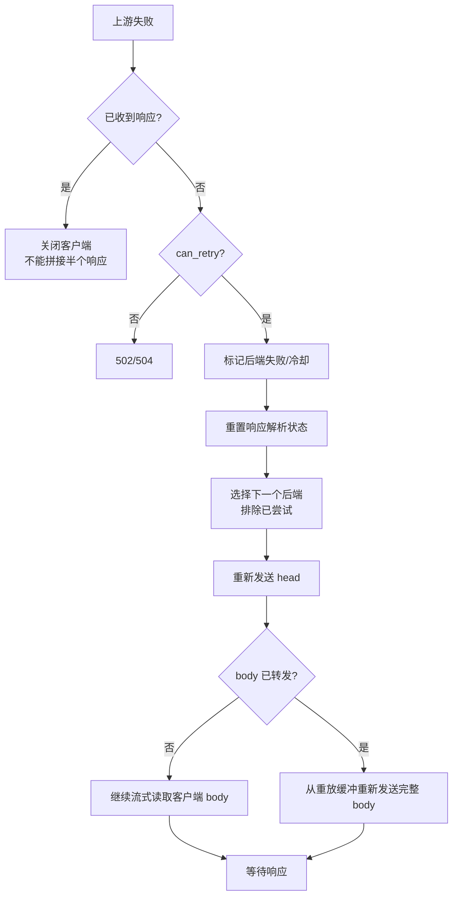

# 重试与错误处理

## 为什么“后端挂了换一台”不够

一个 POST 请求可能已经被后端执行：

1. 代理建立连接、写出请求头；
2. 后端收到并开始创建订单/写入数据库；
3. 后端在返回响应前崩溃；
4. 代理只看到连接断开。

此时如果代理“换一台重发”，用户可能被扣款两次、创建两个订单。**网络失败不等于请求没有生效**。EdgeGate 的重试规则围绕“是否可能产生后端可见副作用”设计。

## 规则

实现位于 [`include/edgegate/retry.hpp`](../include/edgegate/retry.hpp)，是纯函数，便于单测：

```cpp
struct RetryInput {
    std::string method;
    int attempts_done = 0;
    int max_attempts = 2;
    bool idempotent_only = true;
    bool request_bytes_written = false;
    bool body_forwarded = false;
    bool body_complete = false;
    bool body_replayable = false;
    bool response_started = false;
};
```

判定：

| 条件 | 结果 |
| --- | --- |
| `response_started` | 不重试（不能拼接两段响应） |
| `attempts_done >= max_attempts` | 不重试 |
| 非幂等 且 `idempotent_only` 且 `request_bytes_written` | 不重试 |
| 已转发部分 body 且 `!(body_complete && body_replayable)` | 不重试 |
| 其他 | 可重试 |

幂等方法：GET、HEAD、OPTIONS、TRACE、PUT、DELETE。POST/PATCH 默认不重试。

### 为什么连接失败可以重试 POST

如果连接阶段失败（`ECONNREFUSED`、connect timeout、`SO_ERROR`），请求字节还没有写出，后端没有收到请求，自然没有副作用。因此：

```text
POST /orders  ->  connect failed  ->  重试另一个后端   ✅
POST /orders  ->  已写 headers/body  ->  后端断连      ❌ 返回 502
```

### 为什么 PUT 可以重试但也要 body 可重放

PUT 是幂等的，但“幂等”不等于“可以凭空重放”：如果代理只缓存了前 3 MiB body，剩下的 body 已经流式发走，重试时无法重新发送完整 body。因此：

- body 未开始转发 → 可重试；
- body 已完整读取且 ≤ `retry_body_buffer_bytes` → 可重试；
- body 部分转发且超过缓冲上限 → 不重试。

### `idempotent_only=false`

这是一个显式的“危险开关”，允许非幂等请求在写出字节后重试。默认 false 的反面；打开它意味着接受“后端可能执行两次”的风险，只适合明确可去重的场景。集成测试不依赖它。

## 流程



## 状态跟踪

`ClientConn` 中与重试相关的字段：

| 字段 | 含义 |
| --- | --- |
| `attempts` | 已尝试的后端数 |
| `tried` | 已尝试后端列表，防止同一请求反复命中同一实例 |
| `any_request_bytes_written` | 是否真的有字节通过 `send()` 写出（不是“已排队”） |
| `body_forwarded` | 是否写出过 body |
| `replay_body` | 解码后的 body 缓冲 |
| `replay_ok` | 是否完整保存、可重放 |
| `req_body_done` | 客户端 body 是否已完整读取 |
| `response_started` | 是否已收到最终响应头 |

注意：`any_request_bytes_written` 在 `flush_upstream_out()` 成功 `send()` 后置位，而不是在 append 到 out 时置位。连接失败发生在 flush 之前，仍可安全重试。

## 超时与状态码

- 连接超时、响应头超时、请求超时都走 `on_upstream_failure()`；
- 连接类失败优先返回 504；
- 读写/解析失败返回 502；
- 没有健康后端返回 503；
- 已达到 `max_attempts` 返回 502；
- 客户端已经收到部分响应时不再返回错误响应，而是关闭客户端（客户端会看到截断的响应）。

## 与健康检查的关系

- 被动失败：连接失败立即设置冷却；读写失败/5xx 计入失败计数；
- 主动检查：每 `health_interval_ms` 发 `GET health_path`；成功后清零失败计数；
- 重试选择时排除已尝试后端；如果所有后端都不可用，返回 503，而不是无限循环。

## 集成验证

`tests/integration_test.py` 中的 `test_retry_semantics`：

- 启动一个“读完请求就关闭、不返回响应”的 Python flaky 上游；
- 配置两个后端（flaky 在前、真实 demo 在后），round-robin、`max_attempts=2`、关闭主动健康检查；
- **POST** `/api/echo` 第一次命中 flaky：请求已写出 → 不重试 → 502；`edgegate_retries_total == 0`；
- **GET** `/healthz` 第一次命中 flaky：请求已写出但没有 body，幂等 → 重试真实后端 → 200；`edgegate_retries_total >= 1`。

实际运行输出（节选）：

```text
[ PASS ] retry semantics
```

## 常见错误

1. **按“连接是否成功”判断重试**：不，关键是有没有字节到达后端。
2. **把“请求体已排队”当成“已发送”**：队列里的字节可能还没 flush；用实际 `send()` 成功计数。
3. **重试时复用旧的响应解析器状态**：必须重置 parser/chunk decoder，否则会把上一次半截响应当成新响应。
4. **重试已经开始的响应**：客户端已经收到一部分 body，无法回滚；只能关闭。
5. **在重试时重复计算 body 字节数**：重放 body 不应再次计入 `bytes_in`；只统计第一次转发。
6. **把 5xx 当作可重试**：代理不自动重试 5xx，因为后端可能已经执行了业务逻辑；由业务层决定。
